# ClauseCraft - C4 Architecture Documentation

## Overview

This document provides comprehensive C4 (Context, Container, Component, Code) architecture documentation for ClauseCraft, an AI-powered contract generation and analysis platform.

## Project Summary

**ClauseCraft** is a modern React application that enables users to generate professional legal contracts using AI and analyze clauses for risk assessment. The system leverages Groq's OpenAI-compatible API for LLM capabilities, Supabase Edge Functions for serverless compute, and browser LocalStorage for client-side persistence without requiring user authentication.

---

## Level 1: System Context Diagram

**Purpose**: Shows the big picture of how ClauseCraft fits into the world around it.

### Key Actors & Systems:
- **Users**: Legal professionals, business owners, contract managers
- **ClauseCraft System**: The core application for contract generation and analysis
- **Groq API**: External AI service providing LLM capabilities
- **Browser LocalStorage**: Client-side data persistence

### Interactions:
- Users interact with ClauseCraft to create, edit, and analyze contracts
- ClauseCraft calls Groq API for AI-powered generation and analysis
- All contract data is stored locally in the user's browser for privacy and simplicity

### Diagram

---

## Level 2: Container Diagram

**Purpose**: Shows the high-level technology choices and how responsibilities are distributed.

### Containers:

#### 1. React Web Application (Frontend)
- **Technology**: TypeScript, Vite, React, Tailwind CSS, Shadcn-ui
- **Responsibilities**:
  - Landing page with contract templates
  - Guided questionnaire for contract creation
  - Free-form prompt-based generation
  - Contract editor with real-time AI analysis
  - Risk assessment dashboard
  - Local data management

#### 2. analyze-contract (Supabase Edge Function)
- **Technology**: Deno, TypeScript
- **Responsibilities**:
  - Individual clause analysis
  - Risk scoring and calculation
  - Key insights generation
  - Model fallback handling

#### 3. generate-contract (Supabase Edge Function)
- **Technology**: Deno, TypeScript
- **Responsibilities**:
  - Contract generation from user prompts
  - Text parsing into structured clauses
  - Section type classification
  - Initial risk assessment

#### 4. assess-contract (Supabase Edge Function)
- **Technology**: Deno, TypeScript
- **Responsibilities**:
  - Whole contract assessment
  - Missing clauses detection
  - Compliance issues identification
  - Jurisdiction extraction

### External Dependencies:
- **Groq API**: OpenAI-compatible chat completions API
- **Browser LocalStorage**: Client-side JSON storage for contracts and analyses

### Diagram

---

## Level 3: Component Diagram (React Web Application)

**Purpose**: Shows the major structural building blocks and their relationships within the frontend.

### Page Components:
- **Index Page**: Landing page with navigation and contract templates
- **Questionnaire Page**: Guided form-based contract creation
- **PromptContract Page**: Free-form text-to-contract generation
- **Draft Page**: Main editor with AI analysis capabilities

### Core Components:
- **ContractAnalyzer**: Client wrapper for analyze edge function calls
- **UI Components**: Shadcn-ui component library (Cards, Buttons, Dialogs, etc.)

### Hooks & State Management:
- **useContracts**: LocalStorage management and contract CRUD operations
- **useToast**: User feedback and notification system

### Integrations:
- **Supabase Client**: HTTP client for edge function communication

### Utilities:
- **Utils**: UUID generation, risk calculation, text parsing functions

### Diagram

---

## Level 4: Code Diagram (Draft Page Analysis Flow)

**Purpose**: Shows how the code is organized to deliver key functionality.

### React Components:
- **Draft.tsx**: Main editor component orchestrating the analysis flow
- **Clause Card**: Individual clause display with analysis triggers
- **Risk Badge**: Visual risk indicators (Low/Medium/High)
- **Analysis Dialog**: Modal for displaying detailed insights

### State Management:
- **ContractState**: Current contract data with clauses array
- **AssessmentState**: AI-driven compliance and missing clause data
- **LoadingState**: Analysis progress indicators

### API Functions:
- **analyzeClause()**: Triggers individual clause analysis
- **assessContractAI()**: Calls whole-contract assessment
- **reanalyzeAll()**: Bulk analysis of all clauses

### Utility Functions:
- **calculateInitialRisk()**: Heuristic risk scoring based on keywords
- **extractJurisdictionFromClauses()**: Regex-based jurisdiction detection
- **getRiskBadge()**: Maps risk scores to visual indicators

### Data Flow:
- **parseContractText()**: Converts AI output to structured clauses
- **saveToLocalStorage()**: Persists contract and analysis data

### Diagram

---

## Data Flow Architecture

### Contract Generation Flow:
1. **User Input** → User provides prompt or questionnaire data
2. **AI Generation** → Groq API generates contract text
3. **Text Parsing** → parseContractText() extracts clauses and sections
4. **Risk Calculation** → calculateInitialRisk() assigns initial scores
5. **Storage** → Contract object saved to LocalStorage

### Clause Analysis Flow:
1. **Selection** → User clicks analyze on specific clause
2. **AI Analysis** → Groq API analyzes clause content
3. **Results** → Analysis result with key insights and refined risk score
4. **Update** → Clause updated with analysis data
5. **Persistence** → Updated contract saved to LocalStorage

### Contract Assessment Flow:
1. **Trigger** → User requests compliance or missing clause details
2. **AI Assessment** → Whole contract sent to assess-contract function
3. **Processing** → AI identifies missing clauses and compliance issues
4. **Display** → Results shown in modal dialogs

---

## Deployment Architecture

### Client Environment:
- **Web Browser**: Chrome, Firefox, Safari with modern JavaScript support
- **LocalStorage**: Browser-native storage for contracts and analyses

### Vercel Cloud Platform:
- **CDN**: Global edge network for static asset delivery
- **Build System**: Vite + TypeScript with automatic deployments
- **CI/CD**: Git-based continuous deployment

### Supabase Platform:
- **Deno Edge Runtime**: Serverless functions execution
- **Environment Variables**: Secure storage for API tokens

### Groq Infrastructure:
- **Inference Router**: api.groq.com/openai/v1 endpoint
- **AI Models**: Multiple LLMs with fallback capabilities
  - llama-3.3-70b-versatile
  - llama-3.1-8b-instant

---

## Key Architectural Decisions

### 1. Client-Side Storage
**Decision**: Use browser LocalStorage instead of database
**Rationale**: 
- Eliminates need for user authentication
- Reduces infrastructure complexity
- Ensures data privacy (data never leaves user's device)
- Enables offline functionality

### 2. Serverless Edge Functions
**Decision**: Use Supabase Edge Functions for AI integration
**Rationale**:
- Avoid CORS issues with direct API calls
- Secure API key management
- Automatic scaling and global distribution
- Cost-effective for variable workloads

### 3. Model Fallback Strategy
**Decision**: Implement multiple model attempts with priority ordering
**Rationale**:
- Ensures high availability despite model outages
- Balances quality (larger models first) with reliability
- Handles model-specific limitations gracefully

### 4. Structured Contract Parsing
**Decision**: Parse AI-generated text into typed clause objects
**Rationale**:
- Enables granular risk assessment
- Supports individual clause analysis
- Facilitates contract editing and management
- Provides structured data for UI components

---

## Technology Stack Summary

### Frontend:
- **Framework**: React 18 with TypeScript
- **Build Tool**: Vite
- **Styling**: Tailwind CSS + Shadcn-ui components
- **Routing**: React Router
- **State**: React hooks + localStorage

### Backend:
- **Runtime**: Deno (Supabase Edge Functions)
- **API**: Groq API (OpenAI-compatible)
- **Authentication**: None (anonymous usage)
- **Storage**: Browser LocalStorage

### Infrastructure:
- **Hosting**: Vercel (frontend)
- **Functions**: Supabase Edge Functions
- **AI Models**: Groq (Llama 3.3 70B, Llama 3.1 8B)
- **Domain**: Custom domain with SSL

### Development:
- **Language**: TypeScript
- **Package Manager**: npm
- **Linting**: ESLint
- **Version Control**: Git
- **CI/CD**: Vercel automated deployments

---

## Security Considerations

### Data Privacy:
- All user data stored locally in browser
- No personal data transmitted to servers
- Contracts never stored in external databases

### API Security:
- API keys stored securely in Supabase environment
- CORS policies restrict cross-origin access
- Edge functions validate input parameters

### Content Security:
- AI-generated content is reviewed for appropriateness
- Risk scoring helps identify potentially problematic clauses
- Users maintain full control over final contract content

---

## Scalability & Performance

### Frontend Performance:
- Static site hosting on global CDN
- Code splitting and lazy loading
- Optimized bundle sizes with Vite

### Backend Scalability:
- Serverless functions auto-scale with demand
- Multiple AI model fallbacks prevent bottlenecks
- Edge deployment reduces latency globally

### Storage Efficiency:
- JSON-based local storage
- Efficient data structures for contracts
- Cleanup utilities for storage management

---

## Future Considerations

### Potential Enhancements:
1. **Export Capabilities**: PDF, Word document generation
2. **Template Library**: Expandable contract template system
3. **Collaboration**: Multi-user editing with conflict resolution
4. **Integration**: CRM and document management system APIs
5. **Advanced Analytics**: Contract performance and risk trending

### Technical Evolution:
1. **Progressive Web App**: Offline functionality enhancement
2. **Real-time Collaboration**: WebSocket integration
3. **Advanced AI**: Custom model fine-tuning
4. **Enterprise Features**: Team management and access controls

